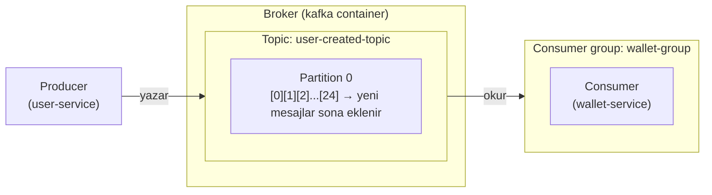
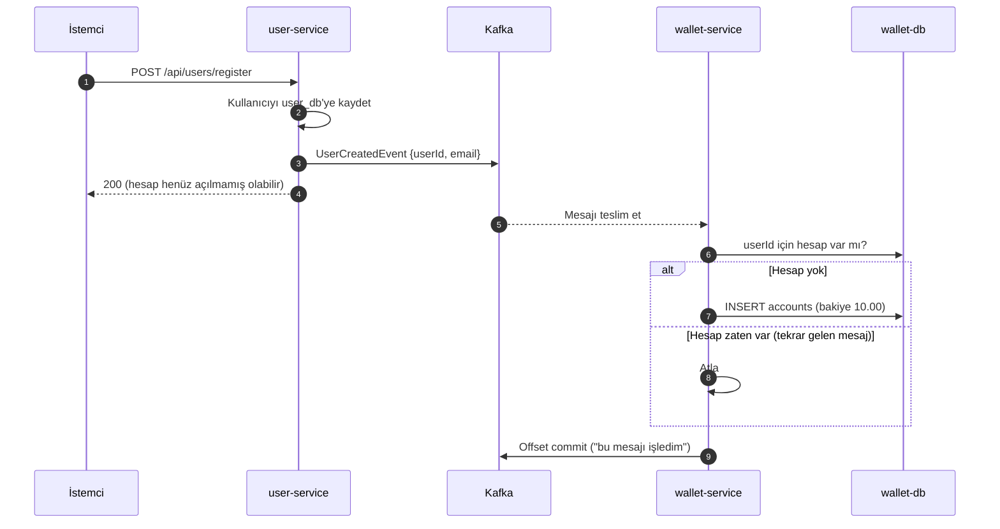
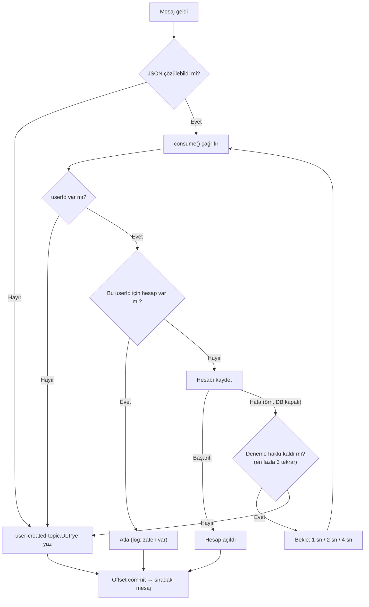

# Kafka Kılavuzu — Bu Projede Kafka Nasıl Çalışıyor?

Bu kılavuz, Kafka deneyimi olmayan bir geliştiricinin projedeki Kafka kodunu okuyup anlayabilmesi ve değiştirebilmesi için yazıldı. Önce temel kavramlar, sonra projede nasıl kullanıldığı, en sonda da hata yönetimi (retry, DLT, idempotency) anlatılıyor. Her ayarın **neden** orada olduğu açıklanıyor.

**Son güncelleme:** 2026-11-03 (#11 düzeltmesiyle birlikte). İlgili dokümanlar: [Teknik Doküman — Bölüm 6](teknik-dokuman.md#6-event-driven-akış-kafka), [Yapılacaklar](yapilacaklar.md).

## İçindekiler

1. [Kafka Nedir, Neden Kullanıyoruz?](#1-kafka-nedir-neden-kullanıyoruz)
2. [Temel Kavramlar](#2-temel-kavramlar)
3. [Bu Projede Kafka](#3-bu-projede-kafka)
4. [Mesajın Byte'a Dönüşmesi: Serileştirme](#4-mesajın-bytea-dönüşmesi-serileştirme)
5. [Offset Commit: "Bu Mesajı İşledim" Demek](#5-offset-commit-bu-mesajı-işledim-demek)
6. [Teslim Garantileri ve Idempotency](#6-teslim-garantileri-ve-idempotency)
7. [Hatalar: Geçici, Kalıcı ve Zehirli Mesaj](#7-hatalar-geçici-kalıcı-ve-zehirli-mesaj)
8. [Retry ve Backoff](#8-retry-ve-backoff)
9. [DLT (Dead Letter Topic)](#9-dlt-dead-letter-topic)
10. [Yapılandırma Satır Satır](#10-yapılandırma-satır-satır)
11. [Bir Mesajın Yolculuğu: Dört Senaryo](#11-bir-mesajın-yolculuğu-dört-senaryo)
12. [Komut Kopya Kağıdı](#12-komut-kopya-kağıdı)
13. [Sık Yapılan Hatalar](#13-sık-yapılan-hatalar)
14. [Açık Kalan Konular](#14-açık-kalan-konular)
15. [Sözlük](#15-sözlük)
16. [Kendinizi Test Edin](#16-kendinizi-test-edin)

---

## 1. Kafka Nedir, Neden Kullanıyoruz?

Kafka, servislerin birbirine **mesaj (event)** bırakıp birbirini beklemeden çalışmasını sağlayan bir mesajlaşma sistemidir.

Bu projede şu iş için kullanılıyor: bir kullanıcı kayıt olduğunda, ona otomatik olarak bir cüzdan hesabı açılması gerekiyor. Kullanıcıyı user-service kaydediyor, hesabı wallet-service açıyor. İki yol var:

| | Doğrudan HTTP çağrısı | Kafka ile event |
|---|---|---|
| Nasıl | user-service, wallet-service'e "hesap aç" isteği atar ve cevabı bekler | user-service "kullanıcı oluştu" mesajını Kafka'ya bırakır ve işine devam eder; wallet-service mesajı kendi hızında okur |
| wallet-service kapalıysa | Kayıt isteği hata verir ya da hesap hiç açılmaz | Mesaj Kafka'da bekler; wallet-service açılınca okuyup hesabı açar |
| Bağımlılık | user-service, wallet-service'i tanımak zorunda | user-service kimin dinlediğini bilmez. Yarın bir "hoş geldin e-postası" servisi de aynı mesajı dinleyebilir, user-service'e dokunmadan |
| Bedeli | Basit | Sonuç anında değil, birkaç saniye içinde oluşur (eventual consistency). Hata yönetimi daha zordur (bu kılavuzun büyük kısmı bunun hakkında) |

**Benzetme:** HTTP çağrısı telefonla aramak gibidir: karşı taraf açmazsa iş olmaz. Kafka ise bir ilan panosu gibidir: mesajı panoya asarsınız; ilgilenen herkes, istediği zaman gelip okur. Pano mesajı okununca silmez.

## 2. Temel Kavramlar



| Kavram | Ne demek | Bu projede |
|---|---|---|
| **Broker** | Kafka sunucusu. Mesajları diske yazar ve saklar. | `kafka` container'ı (tek broker) |
| **Topic** | Mesajların yazıldığı isimli kanal. Veritabanındaki tabloya benzer, ama yalnızca sonuna eklenebilir. | `user-created-topic`, `user-created-topic.DLT` |
| **Partition** | Bir topic'in parçası. Paralellik için topic birden fazla partition'a bölünebilir. Sıra garantisi yalnızca **bir partition içinde** vardır. | Her topic'te 1 partition |
| **Offset** | Bir mesajın partition içindeki sıra numarası (0, 1, 2…). Hiç değişmez. | Kayıt sayısı arttıkça büyür |
| **Producer** | Topic'e mesaj yazan uygulama. | user-service → `UserProducer` |
| **Consumer** | Topic'ten mesaj okuyan uygulama. | wallet-service → `UserConsumer` |
| **Consumer group** | Aynı işi yapan consumer'ların ortak adı. Kafka, her grubun "nereye kadar okuduğunu" ayrı tutar. Bir mesajı bir grup içinde yalnızca bir consumer işler. | `wallet-group` |
| **Committed offset** | Bir grubun "buraya kadar işledim" diye Kafka'ya kaydettiği konum. Consumer yeniden başlarsa buradan devam eder. | [Bölüm 5](#5-offset-commit-bu-mesajı-işledim-demek) |
| **Retention** | Mesajların ne kadar süre saklanacağı. Mesaj **okununca silinmez**; süre dolunca silinir (varsayılan 7 gün). | Varsayılan |
| **KRaft** | Kafka'nın kendi kendini yönettiği mod. Eskiden bunun için ayrı bir Zookeeper gerekiyordu. | Kafka KRaft modunda; compose'taki `zookeeper` servisi kullanılmıyor (#17) |

**Önemli fark:** Klasik kuyruk sistemlerinde (örneğin RabbitMQ) okunan mesaj kuyruktan silinir. Kafka'da mesaj yerinde kalır; consumer yalnızca "nereye kadar okudum" bilgisini (offset) ilerletir. Bu yüzden:
- Aynı mesajı farklı gruplar bağımsız olarak okuyabilir.
- Offset'i geri alarak eski mesajları yeniden işleyebilirsiniz.
- "Mesajı onaylamazsam kuyrukta kalır" düşüncesi Kafka'da **yanlıştır**. Bu, #11 hatasının kaynağıydı ([Bölüm 5.3](#53-eski-kodun-hatası)).

## 3. Bu Projede Kafka

### 3.1 Akış



### 3.2 Dosyalar

| Dosya | Servis | Görevi |
|---|---|---|
| [`UserCreatedEvent.java`](../user-service/src/main/java/com/wallet/user_service/dto/UserCreatedEvent.java) | user-service | Mesajın içeriği: `record UserCreatedEvent(Long userId, String email)` |
| [`UserProducer.java`](../user-service/src/main/java/com/wallet/user_service/messaging/UserProducer.java) | user-service | `kafkaTemplate.send("user-created-topic", event)` ile mesajı gönderir |
| [`application.properties`](../user-service/src/main/resources/application.properties) | user-service | Producer ayarları: bağlantı adresi, serializer'lar |
| [`UserCreatedEvent.java`](../wallet-service/src/main/java/com/wallet/user_service/dto/UserCreatedEvent.java) | wallet-service | Mesaj sınıfının **aynı paket adıyla** kopyası ([Bölüm 4](#4-mesajın-bytea-dönüşmesi-serileştirme)) |
| [`UserConsumer.java`](../wallet-service/src/main/java/com/wallet/wallet_service/messaging/UserConsumer.java) | wallet-service | `@KafkaListener` ile mesajı okur, hesabı açar |
| [`KafkaErrorHandlingConfig.java`](../wallet-service/src/main/java/com/wallet/wallet_service/config/KafkaErrorHandlingConfig.java) | wallet-service | Hata yönetimi: retry, DLT, DLT topic'i |
| [`application.properties`](../wallet-service/src/main/resources/application.properties) | wallet-service | Consumer ayarları |

### 3.3 Spring Kafka ne yapıyor?

Kafka'nın kendi Java kütüphanesi düşük seviyelidir: bağlantı açarsınız, döngü içinde `poll()` ile mesaj çekersiniz, offset'leri elle yönetirsiniz. **Spring Kafka** bunları sizin yerinize yapar:

- **`KafkaTemplate`** (producer tarafı): `send(topic, nesne)` çağrısı yeterli; bağlantı ve serileştirme arka planda halledilir.
- **`@KafkaListener`** (consumer tarafı): Spring arka planda bir **listener container** oluşturur. Container ayrı bir thread'de sürekli `poll()` yapar, gelen her mesaj için sizin metodunuzu çağırır, metot başarıyla biterse offset'i commit eder. Metot exception fırlatırsa **error handler**'a (bizde `DefaultErrorHandler`) haber verir.
- **Spring Boot** `application.properties`'teki `spring.kafka.*` ayarlarını okuyup bunları otomatik kurar. Context'te bir `CommonErrorHandler` bean'i (`DefaultErrorHandler` bu tiptedir) varsa onu container'a kendisi bağlar.

## 4. Mesajın Byte'a Dönüşmesi: Serileştirme

Kafka yalnızca byte dizisi saklar; Java nesnesinden haberi yoktur. Bu yüzden:

- **Producer** nesneyi byte'a çevirir (**serializer**).
- **Consumer** byte'ı nesneye çevirir (**deserializer**).

Her mesajın bir **key**'i ve bir **value**'su vardır; her ikisi için ayrı ayar yapılır. Bu projede key kullanılmıyor (`null`), value JSON.

### 4.1 Producer tarafı (user-service)

```properties
spring.kafka.producer.key-serializer=org.apache.kafka.common.serialization.StringSerializer
spring.kafka.producer.value-serializer=org.springframework.kafka.support.serializer.JsonSerializer
```

`JsonSerializer` nesneyi JSON'a çevirir ve mesaja bir **header** ekler:

```
__TypeId__ : com.wallet.user_service.dto.UserCreatedEvent
value      : {"userId":21,"email":"ali@x.com"}
```

Header, mesajın yanında taşınan anahtar–değer etiketidir (HTTP header'larına benzer). `__TypeId__`, karşı tarafa "bunu hangi sınıfa çevir" bilgisini verir.

### 4.2 Consumer tarafı (wallet-service)

Consumer `__TypeId__`'deki sınıf adını kendi classpath'inde arar. Bu yüzden wallet-service'te de `com.wallet.user_service.dto.UserCreatedEvent` adında, **aynı paket ve aynı alanlarla** bir record var. Paket adı farklı olsaydı consumer sınıfı bulamaz, mesajı çözemezdi.

> İki servisteki `UserCreatedEvent` her zaman aynı tutulmalıdır. Bir alana isim değişikliği yaparsanız iki tarafı birlikte değiştirin.

### 4.3 `ErrorHandlingDeserializer` neden var?

Deserialization, mesaj sizin metodunuza ulaşmadan **önce**, Kafka kütüphanesinin `poll()` çağrısı içinde yapılır. Doğrudan `JsonDeserializer` kullanılırken bozuk bir mesaj gelirse:

1. `poll()` exception fırlatır.
2. Offset ilerlemez, consumer aynı mesajı tekrar çeker.
3. Yine exception… Consumer bu mesajda **sonsuza kadar takılır**, arkasındaki sağlam mesajlar da işlenmez.

`ErrorHandlingDeserializer` asıl işi yine `JsonDeserializer`'a yaptırır (bu yüzden **delegate** ayarı var), ama hata olursa exception fırlatmaz. Değeri `null` yapar, hatayı ve mesajın ham byte'larını header'a koyar. Container bunu görünce metodu çağırmaz, durumu doğrudan error handler'a iletir. Error handler da mesajı DLT'ye gönderir.

## 5. Offset Commit: "Bu Mesajı İşledim" Demek

### 5.1 Neden önemli?

Consumer yeniden başladığında (deploy, çökme, yeniden dengeleme) Kafka'ya "nereden devam edeyim" diye sorar. Cevap, grubun **son commit ettiği offset**'tir. Bu yüzden commit'in **ne zaman** yapıldığı kritiktir:

| Commit ne zaman | Çökme olursa | Sonuç |
|---|---|---|
| İşlemden **önce** | İşlenmemiş mesaj "işlendi" sayılır | Mesaj **kaybolur** |
| İşlemden **sonra** | İşlenmiş ama commit'i yapılmamış mesaj tekrar gelir | Mesaj **iki kez** işlenir |

İkinci durum her zaman tercih edilir, çünkü tekrar gelen mesajın etkisi idempotency ile zararsız hale getirilebilir ([Bölüm 6](#6-teslim-garantileri-ve-idempotency)). Kaybolan mesaj ise geri getirilemez.

### 5.2 Ack modları

`spring.kafka.listener.ack-mode` ayarı, Spring'in offset'i ne zaman commit edeceğini belirler:

| Mod | Ne zaman commit | Not |
|---|---|---|
| `batch` (varsayılan) | Bir `poll()`'la gelen tüm mesajlar işlenince | |
| **`record`** (bizde) | **Her mesaj** başarıyla işlenince | Basit ve anlaşılır; düşük trafikte ek maliyeti önemsiz |
| `manual` / `manual_immediate` | Siz `ack.acknowledge()` çağırınca | Metoda `Acknowledgment` parametresi eklenir. Ancak ack çağrılmayan mesaj tekrar **gönderilmez** |

### 5.3 Eski kodun hatası

Eski `UserConsumer` `manual_immediate` kullanıyordu ve hata olunca exception'ı yakalayıp ack çağırmıyordu. Koddaki yorum "ack çağırmazsak mesaj kuyrukta kalır" diyordu. Kafka'da gerçekte olan şuydu:

```
Offset 10: hata → yakalandı, ack yok            (commit edilen offset hâlâ 10)
Offset 11: başarılı → ack                         (commit edilen offset 12 oldu)
                                                   → offset 10 bir daha asla okunmaz
```

Consumer, ack edilmeyen mesajı beklemez; bir sonrakine geçer. Sonraki mesaj ack edildiğinde offset 10'un da ilerisine geçilir. Kullanıcı cüzdansız kalır ve bunu yalnızca bir log satırı gösterir.

Yeni kodda `try/catch` yok. Exception metottan çıkar ve error handler'a ulaşır: önce tekrar denenir, olmazsa DLT'ye yazılır. **Offset ancak mesaj başarıyla işlendikten ya da DLT'ye güvenle yazıldıktan sonra** ilerler.

## 6. Teslim Garantileri ve Idempotency

### 6.1 Üç garanti seviyesi

| Garanti | Anlamı | Ne zaman |
|---|---|---|
| **At-most-once** (en fazla bir kez) | Mesaj ya bir kez işlenir ya hiç | Önce commit, sonra işlem. Kayıp olabilir |
| **At-least-once** (en az bir kez) | Mesaj kesin işlenir, ama birden fazla kez işlenebilir | Önce işlem, sonra commit. **Bizim kurulumumuz** |
| **Exactly-once** (tam bir kez) | Ne kayıp ne tekrar | Kafka transaction'ları gerektirir. Ancak işlem harici bir veritabanına yazıyorsa Kafka bunu tek başına garanti edemez |

### 6.2 Mesaj neden iki kez gelir?

At-least-once'da tekrar kaçınılmazdır. Birkaç örnek:

- wallet-service hesabı kaydetti, offset commit'inden hemen önce container yeniden başladı.
- Consumer'ın işi uzun sürdü (`max.poll.interval.ms`, varsayılan 5 dk, aşıldı); Kafka consumer'ı ölü sayıp mesajı yeniden dağıttı.
- user-service mesajı gönderdi, ağ hatası yüzünden onay alamadı ve tekrar gönderdi.
- Birisi offset'i elle geri aldı ya da DLT'deki mesajı ana topic'e geri gönderdi.

### 6.3 Idempotency

**Idempotent** işlem, kaç kez çalıştırılırsa çalıştırılsın sonucu bir kez çalıştırılmışla aynı olan işlemdir. Örneğin "bakiyeyi 100 yap" idempotenttir, "bakiyeye 10 ekle" değildir.

"Hesap aç" doğal olarak idempotent değildir: her çalıştırmada yeni bir hesap açar. Bu yüzden consumer'da kontrol var:

```java
if (accountRepository.existsByUserId(event.userId())) {
    log.info("userId={} için hesap zaten var, tekrar gelen event atlandı", event.userId());
    return;   // metot başarıyla biter → offset commit edilir
}
```

**Bu kontrolün sınırı:** Kullanıcının **herhangi bir** hesabı varsa event atlanır. Kafka uzun süre gecikirse ve kullanıcı bu arada elle hesap açarsa, otomatik hesabı açılmaz. Daha katı çözüm, her event'e benzersiz bir `eventId` verip işlenen id'leri bir tabloda tutmaktır (**inbox pattern**). Bu projenin boyutunda `userId` kontrolü yeterli görüldü.

**Yarış durumu neden yok:** Topic'in tek partition'ı var ve onu tek consumer okuyor. Aynı event'in iki kopyası aynı anda değil, sırayla işlenir. Partition veya consumer sayısı artırılırsa, aynı `userId`'li mesajların aynı partition'a düşmesi için mesaja `userId` key olarak verilmeli. Ek güvenlik için veritabanında da kısıt düşünülebilir.

## 7. Hatalar: Geçici, Kalıcı ve Zehirli Mesaj

Consumer'da oluşabilecek hatalar iki gruba ayrılır. Hata yönetiminin bütün mantığı bu ayrıma dayanır:

| Tür | Örnek | Tekrar denemek işe yarar mı? | Ne yapılır |
|---|---|---|---|
| **Geçici (transient)** | Veritabanı yeniden başlıyor, ağ kopması, kilit zaman aşımı | **Evet**, birkaç saniye sonra düzelebilir | Bekleyip tekrar dene |
| **Kalıcı (permanent)** | Bozuk JSON, `userId` eksik, kodda bug | **Hayır**, mesaj kaç kez denenirse denensin aynı hatayı verir | Hemen kenara ayır (DLT) |

**Zehirli mesaj (poison pill):** Hiçbir zaman başarıyla işlenemeyecek mesajdır. Kafka'da sıra korunduğu için zehirli mesaj kenara ayrılmazsa partition'ı tıkar; arkasındaki bütün sağlam mesajlar bekler. Bizim örnekte bu, o andan sonra kayıt olan **hiçbir kullanıcıya** hesap açılmaması demektir.

## 8. Retry ve Backoff

**Retry:** Başarısız işlemi tekrar denemek. **Backoff:** Denemeler arasında beklemek.

```java
ExponentialBackOffWithMaxRetries backOff = new ExponentialBackOffWithMaxRetries(3);
backOff.setInitialInterval(1_000L);   // ilk bekleme 1 sn
backOff.setMultiplier(2.0);           // her seferinde 2 katı
backOff.setMaxInterval(10_000L);      // tek bekleme en fazla 10 sn
```

```
1. deneme ✗ → 1 sn bekle → 2. deneme ✗ → 2 sn bekle → 3. deneme ✗ → 4 sn bekle → 4. deneme ✗ → DLT
           (1 ilk deneme + 3 tekrar = toplam 4 deneme, ~7 sn bekleme)
```

**Neden üstel (exponential)?** Sabit ve sık denemeler, toparlanmaya çalışan bir veritabanına sürekli yük bindirir. Bekleme süresini katlayarak artırmak sisteme nefes alma zamanı verir.

**Neden sınırlı?** Sınırsız deneme zehirli mesajla aynı sonucu doğurur: partition tıkanır.

**Bilinmesi gereken:** `DefaultErrorHandler`'ın denemeleri **bloklayıcıdır**. Bekleme süresince consumer o partition'daki diğer mesajları işlemez. Bizim için uygun, çünkü toplam bekleme ~7 saniye ve trafik düşük. Toplam bekleme `max.poll.interval.ms`'den (5 dk) kısa olmalıdır; aksi halde Kafka consumer'ı ölü sayar. Uzun beklemeler gerekirse Spring Kafka'nın `@RetryableTopic` özelliği (bloklamayan, ayrı retry topic'leri kullanan yöntem) değerlendirilebilir.

**Hangi hatalar tekrar denenmez?**

| Exception | Neden |
|---|---|
| `DeserializationException` (bozuk JSON) | Spring Kafka varsayılanı |
| `MessageConversionException`, `ClassCastException` vb. | Spring Kafka varsayılanı |
| `InvalidRequestException` | Bizim eklediğimiz: `errorHandler.addNotRetryableExceptions(InvalidRequestException.class)`. `userId` eksikse 4 kez denemek bir şey değiştirmez |

Bunlar hiç beklemeden doğrudan DLT'ye gider.

## 9. DLT (Dead Letter Topic)

### 9.1 DLT ne demek?

**Dead Letter** (ölü mektup), postanede adresine teslim edilemeyen mektuplara verilen addır. Bu mektuplar çöpe atılmaz; ayrı bir rafa konur, sonra incelenip ya düzeltilerek tekrar gönderilir ya da göndericiye iade edilir.

Mesajlaşma sistemlerinde de aynı fikir uygulanır: **işlenemeyen mesajlar silinmez, ayrı bir topic'e taşınır.** Bu topic'e **Dead Letter Topic (DLT)** denir. RabbitMQ gibi kuyruk sistemlerinde aynı kavramın adı **Dead Letter Queue (DLQ)**'dur.

Bizde:

| | |
|---|---|
| Ana topic | `user-created-topic` |
| DLT | `user-created-topic.DLT` (Spring Kafka'nın varsayılan isimlendirmesi: `<topic>.DLT`) |
| Ne zaman yazılır | Mesaj tekrar denenemeyen bir hatayla karşılaştığında ya da tüm denemeler tükendiğinde |
| Kim yazar | `DeadLetterPublishingRecoverer` |
| Kim okur | Şu an kimse. İnceleme elle yapılır ([9.4](#94-dlt-nasıl-incelenir)) |

### 9.2 DLT olmasaydı ne olurdu?

İşlenemeyen bir mesaj için yalnızca üç seçenek kalırdı:

1. **Atlamak:** Mesaj kaybolur (eski kodun yaptığı).
2. **Sonsuza kadar denemek:** Partition tıkanır, yeni kullanıcılara hesap açılmaz.
3. **Uygulamayı durdurmak:** Tüm sistem durur.

DLT dördüncü bir seçenek sunar: **mesajı kaybetmeden yoldan çekmek.** Ana akış devam eder, sorunlu mesaj daha sonra incelenmek üzere saklanır.

### 9.3 DLT'deki mesajda ne var?

DLT'ye yazılan mesaj, orijinal mesajın **aynısıdır** (bozuk JSON'da ham byte'lar). Ek olarak hatayı açıklayan header'lar eklenir:

| Header | İçeriği |
|---|---|
| `kafka_dlt-exception-fqcn` | Fırlatılan exception sınıfı (örn. `ListenerExecutionFailedException`) |
| `kafka_dlt-exception-cause-fqcn` | Asıl neden (örn. `com.wallet.common.exception.InvalidRequestException`) |
| `kafka_dlt-exception-message` | Hata mesajı |
| `kafka_dlt-exception-stacktrace` | Tam stack trace |
| `kafka_dlt-original-topic` / `-partition` / `-offset` | Mesajın ana topic'teki yeri |
| `kafka_dlt-original-timestamp` | Mesajın ilk yazıldığı zaman |
| `kafka_dlt-original-consumer-group` | Mesajı işleyemeyen grup (`wallet-group`) |

`original-partition`, `original-offset` ve `original-timestamp` ikili (binary) sayı olarak saklandığı için konsolda okunamayan karakterler olarak görünür. Bu normaldir.

### 9.4 DLT nasıl incelenir?

```bash
docker exec kafka kafka-console-consumer --bootstrap-server kafka:9092 \
  --topic user-created-topic.DLT --from-beginning --timeout-ms 5000 \
  --property print.headers=true
```

Örnek çıktı (stack trace kısaltıldı):

```
kafka_dlt-exception-fqcn:org.springframework.kafka.listener.ListenerExecutionFailedException,
kafka_dlt-exception-cause-fqcn:com.wallet.common.exception.InvalidRequestException,
kafka_dlt-exception-message:Listener method '...consume(...)' threw exception,
...   {"email":"eksik@x.com"}
```

Burada mesajın `userId` içermediği ve bu yüzden reddedildiği görülüyor.

### 9.5 DLT'deki mesaj nasıl yeniden işlenir?

Önce hatanın nedeni giderilir (kod düzeltilir, veritabanı açılır vb.). Sonra mesaj ana topic'e tekrar yazılır:

```bash
echo '{"userId":21,"email":"ali@x.com"}' | \
  docker exec -i kafka kafka-console-producer --bootstrap-server kafka:9092 --topic user-created-topic
```

Consumer idempotent olduğu için bu güvenlidir: hesap zaten açıldıysa mesaj atlanır, ikinci hesap oluşmaz. **İdempotency ile DLT birbirini tamamlar:** DLT mesajın kaybolmamasını, idempotency de yeniden göndermenin zararsız olmasını sağlar.

### 9.6 DLT'nin sınırları

- DLT kendi başına hiçbir şeyi düzeltmez; yalnızca mesajı saklar. **Birinin bakması gerekir.** Üretim ortamında DLT'de mesaj biriktiğinde alarm üreten bir izleme kurulmalıdır.
- DLT'deki mesajlar da retention süresine tabidir (varsayılan 7 gün). Bu süre içinde incelenmeyen mesajlar silinir.
- DLT'ye yazma da başarısız olabilir (örneğin Kafka erişilemezse). Bu durumda `DefaultErrorHandler` offset'i ilerletmez ve mesajı yeniden dener; mesaj kaybolmaz.

## 10. Yapılandırma Satır Satır

### 10.1 wallet-service `application.properties`

```properties
spring.kafka.bootstrap-servers=${KAFKA_BOOTSTRAP_SERVERS}
```
Kafka'nın adresi. Compose'ta `kafka:9092`. "Bootstrap" denmesinin nedeni: client önce bu adrese bağlanır, cluster'daki diğer broker'ların listesini oradan öğrenir.

```properties
spring.kafka.consumer.group-id=wallet-group
```
Consumer grubunun adı. Offset'ler bu isimle saklanır. Değiştirirseniz Kafka sizi yeni bir grup sayar ve aşağıdaki `auto-offset-reset` kuralı devreye girer.

```properties
spring.kafka.consumer.auto-offset-reset=earliest
```
Grubun **hiç commit edilmiş offset'i yoksa** nereden başlanacağı. `earliest`: topic'in en başından; `latest`: yalnızca bundan sonra gelenlerden. Grubun commit edilmiş bir offset'i varsa bu ayar dikkate alınmaz.

```properties
spring.kafka.consumer.key-deserializer=org.apache.kafka.common.serialization.StringDeserializer
```
Key'i String olarak çöz. Bizde key `null`, ama ayarın tanımlı olması gerekir.

```properties
spring.kafka.consumer.value-deserializer=org.springframework.kafka.support.serializer.ErrorHandlingDeserializer
spring.kafka.consumer.properties.spring.deserializer.value.delegate.class=org.springframework.kafka.support.serializer.JsonDeserializer
```
Value'yu `ErrorHandlingDeserializer` ile, onun da içinde `JsonDeserializer` ile çöz ([4.3](#43-errorhandlingdeserializer-neden-var)). `spring.kafka.consumer.properties.*` altındaki ayarlar Kafka client'ına olduğu gibi aktarılır.

```properties
spring.kafka.consumer.properties.spring.json.value.default.type=com.wallet.user_service.dto.UserCreatedEvent
```
Mesajda `__TypeId__` header'ı yoksa hangi sınıfa çevrileceği. user-service her zaman header ekler; bu ayar, header'sız mesajları (örneğin konsoldan elle yazılan test mesajlarını) da işleyebilmek için.

```properties
spring.kafka.consumer.properties.spring.json.trusted.packages=*
```
`__TypeId__` header'ında hangi paketlerdeki sınıflara izin verileceği. `*` "hepsi" demektir. Header'ı mesajı gönderen belirlediği için bu geniş bir izindir; yalnızca `com.wallet.user_service.dto` ile sınırlandırılmalıdır (#16).

```properties
spring.kafka.listener.ack-mode=record
```
Her mesaj başarıyla işlenince offset'i commit et ([5.2](#52-ack-modları)).

### 10.2 `KafkaErrorHandlingConfig`

**`userCreatedDltTopic()` — `NewTopic` bean'i**

```java
TopicBuilder.name(USER_CREATED_DLT).partitions(1).replicas(1).build();
```
Spring Boot'un oluşturduğu `KafkaAdmin`, uygulama açılırken context'teki `NewTopic` bean'lerine bakar ve olmayan topic'leri oluşturur. DLT'nin önceden var olması, ilk hata anında topic oluşturma gecikmesi veya hatasıyla uğraşmamak içindir.
- `partitions(1)`: `DeadLetterPublishingRecoverer` varsayılan olarak mesajı DLT'nin **orijinal mesajla aynı numaralı** partition'ına yazar. Bu yüzden DLT'nin partition sayısı ana topic'inkinden az olmamalıdır. Ana topic büyütülürse DLT de büyütülmelidir.
- `replicas(1)`: Tek broker olduğu için 1. Üretimde genellikle 3 olur.

**`deadLetterKafkaTemplate()` — DLT'ye yazacak producer**

wallet-service normalde mesaj üretmediği için producer ayarı yok. Spring Boot'un varsayılan `KafkaTemplate`'i `StringSerializer` kullanır ve `UserCreatedEvent` nesnesini yazamaz. Bu yüzden DLT'ye özel bir template tanımlandı:

```java
valueSerializers.put(byte[].class, new ByteArraySerializer());   // bozuk mesajın ham byte'ları
valueSerializers.put(Object.class, new JsonSerializer<>());      // çözülmüş nesneler → JSON
... new DelegatingByTypeSerializer(valueSerializers, true)
```

DLT'ye iki tür değer yazılabilir:
- Mesaj başarıyla çözülmüş ama işlenememiş: elimizde `UserCreatedEvent` nesnesi var, JSON olarak yazılır.
- Mesaj hiç çözülememiş (bozuk JSON): elimizde yalnızca ham byte'lar var, olduğu gibi yazılır.

`DelegatingByTypeSerializer`, değerin tipine bakıp uygun serializer'ı seçer. İkinci parametre (`true`), tipin tam eşleşmesi yerine alt sınıfları da kabul etmesini sağlar (`Object.class` her şeyi kapsar). Kontrol sırayla yapıldığı için `LinkedHashMap` kullanılıyor ve `byte[]` önce yazılıyor; aksi halde `Object` kuralı byte dizisini de yakalar.

**`kafkaErrorHandler()` — `DefaultErrorHandler`**

```java
DeadLetterPublishingRecoverer recoverer = new DeadLetterPublishingRecoverer(deadLetterKafkaTemplate);
DefaultErrorHandler errorHandler = new DefaultErrorHandler(recoverer, backOff);
errorHandler.addNotRetryableExceptions(InvalidRequestException.class);
```

- **Recoverer:** Denemeler tükendiğinde ne yapılacağı. `DeadLetterPublishingRecoverer` mesajı DLT'ye yazar.
- **BackOff:** Kaç kez, ne aralıklarla deneneceği ([Bölüm 8](#8-retry-ve-backoff)).
- **Not retryable:** Hiç denenmeden doğrudan recoverer'a gidecek exception'lar.

Recoverer başarılı olduktan sonra error handler offset'i commit eder; consumer bir sonraki mesaja geçer.

### 10.3 `UserConsumer`

| Kod | Neden |
|---|---|
| `@KafkaListener(topics = ..., groupId = "wallet-group")` | Spring'e bu metodu topic'e bağlamasını söyler |
| `@Transactional` | Metot exception ile biterse veritabanı değişiklikleri geri alınır; tekrar deneme temiz bir durumdan başlar |
| `try/catch` **yok** | Exception yakalanıp yutulursa error handler hatadan haberdar olmaz; retry ve DLT çalışmaz |
| `Acknowledgment` parametresi **yok** | `ack-mode=record` ile commit'i container yapar |
| `userId == null` → `InvalidRequestException` | Eksik veri kalıcı bir hatadır; denenmeden DLT'ye gider |
| `existsByUserId` kontrolü | Idempotency ([6.3](#63-idempotency)) |

**Dikkat:** Veritabanı transaction'ı ile Kafka offset commit'i **ayrı** işlemlerdir. Veritabanı commit edilip offset commit edilmeden önce çökme olursa, mesaj tekrar gelir. Bu durumu `existsByUserId` kontrolü karşılar.

## 11. Bir Mesajın Yolculuğu: Dört Senaryo



| Senaryo | Mesaj | Sonuç | Logda görünen |
|---|---|---|---|
| Normal kayıt | `{"userId":21,"email":"..."}` | Hesap açılır | `userId=21 için otomatik hesap açıldı: ACC-...` |
| Tekrar gelen mesaj | Aynı `userId` | Atlanır, ikinci hesap açılmaz | `userId=21 için hesap zaten var, tekrar gelen event atlandı` |
| Bozuk JSON | `bu-json-degil` | Denemeden DLT | Deserialization hatası |
| Eksik veri | `{"email":"..."}` | Denemeden DLT | `InvalidRequestException` |
| Geçici hata | Normal mesaj, DB kapalı | 4 deneme, sonra DLT | Her deneme için hata, sonunda DLT'ye yazıldı bilgisi |

İlk dört senaryo 2026-11-03'te çalışan sistemde test edildi ([Değişiklik Kaydı](degisiklikler.md)).

## 12. Komut Kopya Kağıdı

Tüm komutlar Kafka container'ının içinde çalıştırılır (`docker exec kafka ...`).

**Topic'leri listele:**
```bash
docker exec kafka kafka-topics --bootstrap-server kafka:9092 --list
```

**Topic ayrıntısı (partition sayısı vb.):**
```bash
docker exec kafka kafka-topics --bootstrap-server kafka:9092 --describe --topic user-created-topic
```

**Topic'teki tüm mesajları offset ve header'larıyla oku** (okuma offset'leri etkilemez; consumer group kullanılmaz):
```bash
docker exec kafka kafka-console-consumer --bootstrap-server kafka:9092 \
  --topic user-created-topic --from-beginning --timeout-ms 5000 \
  --property print.headers=true --property print.offset=true
```
Örnek çıktı:
```
Offset:24  __TypeId__:com.wallet.user_service.dto.UserCreatedEvent  {"userId":21,"email":"kafkatest9488@x.com"}
```

**Topic'e elle mesaj yaz** (test için):
```bash
echo '{"userId":21,"email":"test@x.com"}' | \
  docker exec -i kafka kafka-console-producer --bootstrap-server kafka:9092 --topic user-created-topic
```

**Consumer grubunun durumu (en önemli izleme komutu):**
```bash
docker exec kafka kafka-consumer-groups --bootstrap-server kafka:9092 --describe --group wallet-group
```
Örnek çıktı:
```
GROUP         TOPIC               PARTITION  CURRENT-OFFSET  LOG-END-OFFSET  LAG
wallet-group  user-created-topic  0          25              25              0
```
- `CURRENT-OFFSET`: grubun commit ettiği konum (sıradaki okunacak mesaj).
- `LOG-END-OFFSET`: topic'e yazılan son mesajın bir sonrası.
- `LAG`: henüz işlenmemiş mesaj sayısı. Sürekli artıyorsa consumer takılmış veya yavaştır.

**Offset'i geri al (mesajları yeniden işlet):** Önce wallet-service durdurulmalıdır; aktif üyesi olan grubun offset'i değiştirilemez.
```bash
docker compose stop wallet-service
docker exec kafka kafka-consumer-groups --bootstrap-server kafka:9092 \
  --group wallet-group --topic user-created-topic --reset-offsets --to-offset 20 --execute
docker compose start wallet-service
```
Consumer idempotent olduğu için daha önce hesap açılmış kullanıcılar atlanır.

**wallet-service'in Kafka loglarını izle:**
```bash
docker compose logs -f wallet-service | grep -E "UserConsumer|partitions assigned|DLT"
```

## 13. Sık Yapılan Hatalar

| Hata | Sonuç | Doğrusu |
|---|---|---|
| Listener içinde exception'ı yakalayıp yalnızca loglamak | Mesaj kaybolur; retry ve DLT devreye girmez | Exception'ı fırlat ya da yeniden fırlat |
| "Ack etmezsem mesaj kuyrukta kalır" sanmak | Mesaj atlanır ([5.3](#53-eski-kodun-hatası)) | Hata yönetimini error handler'a bırak |
| Sınırsız retry | Zehirli mesaj partition'ı tıkar | Sınırlı retry + DLT |
| Consumer'ı idempotent yazmamak | Tekrar gelen mesaj iki kez işlenir | İşlemden önce "zaten yapıldı mı?" kontrolü |
| İki servisteki event sınıfının paket adı veya alanlarının farklı olması | Mesaj çözülemez, DLT'ye düşer | İki tarafı birlikte değiştir |
| Partition'ı artırıp DLT'yi tek bırakmak | DLT'ye yazma başarısız olur | DLT partition sayısını da artır |
| Listener'da uzun süren iş (dakikalar) | `max.poll.interval.ms` aşılır, Kafka mesajı başka consumer'a verir, iş iki kez yapılır | İşi kısa tut ya da ayarı artır |
| `auto-offset-reset`'in her açılışta geçerli olduğunu sanmak | Beklenmeyen davranış | Yalnızca commit edilmiş offset'i olmayan gruplar için geçerli |

## 14. Açık Kalan Konular

| # | Konu | Açıklama |
|---|---|---|
| 12 | Producer tarafı atomik değil | user-service kullanıcıyı veritabanına kaydedip **sonra** Kafka'ya mesaj gönderiyor. Bu ikisi arasında hata olursa kullanıcı kayıtlı ama mesaj hiç gönderilmemiş olur; DLT bunu kurtaramaz çünkü mesaj Kafka'ya hiç ulaşmamıştır. Çözüm: **transactional outbox**. Mesaj, kullanıcıyla aynı veritabanı transaction'ında bir `outbox` tablosuna yazılır; ayrı bir süreç bu tabloyu okuyup Kafka'ya gönderir. |
| 16 | `trusted.packages=*` | Yalnızca `com.wallet.user_service.dto` paketine izin verilmeli. |
| 33 | DLT izleme ve yeniden işleme | DLT'de mesaj biriktiğinde alarm yok; mesajlar elle ana topic'e geri gönderiliyor. |
| — | Mesaj key'i yok | Şu an tek partition olduğu için sorun değil. Partition artırılırsa `userId` key olarak verilmeli ([6.3](#63-idempotency)). |
| 18 | `cp-kafka:latest` | Sürüm sabitlenmeli. |
| 24 | Test yok | Testcontainers ile gerçek bir Kafka'ya karşı consumer testleri yazılabilir. |

## 15. Sözlük

| Terim | Anlamı |
|---|---|
| Ack (acknowledgment) | Mesajın işlendiğinin onaylanması; Kafka'da offset commit'i tetikler |
| At-least-once | Mesajın en az bir kez, gerekirse birden fazla kez işlenmesi garantisi |
| Backoff | Tekrar denemeler arasındaki bekleme |
| Bootstrap server | Client'ın cluster'a ilk bağlandığı broker adresi |
| Broker | Kafka sunucusu |
| Consumer group | Aynı işi paylaşan consumer'ların grubu; offset'ler grup bazında tutulur |
| DLT / DLQ | Dead Letter Topic / Queue: işlenemeyen mesajların taşındığı yer |
| Deserialization | Byte'ları nesneye çevirme |
| Event | "Şu oldu" bilgisini taşıyan mesaj (örn. "kullanıcı oluşturuldu") |
| Eventual consistency | Sonucun anında değil, kısa bir gecikmeyle tutarlı hale gelmesi |
| Header | Mesajın yanında taşınan anahtar–değer etiketleri |
| Idempotency | Bir işlemin kaç kez çalıştırılırsa çalıştırılsın aynı sonucu vermesi |
| Inbox pattern | İşlenen mesaj id'lerini tabloda tutarak tekrarı engelleme yöntemi |
| Lag | Bir grubun henüz işlemediği mesaj sayısı |
| Listener container | Spring'in `poll()` döngüsünü çalıştıran ve `@KafkaListener` metodunu çağıran bileşeni |
| Offset | Mesajın partition içindeki sıra numarası |
| Outbox pattern | Mesajı önce veritabanına yazıp sonra Kafka'ya göndererek atomikliği sağlama yöntemi |
| Partition | Topic'in parçası; sıra garantisi partition içindedir |
| Poison pill | Hiçbir zaman işlenemeyecek, kenara ayrılmazsa akışı tıkayan mesaj |
| Producer / Consumer | Mesaj yazan / okuyan uygulama |
| Retention | Mesajların saklanma süresi |
| Serialization | Nesneyi byte'a çevirme |
| Topic | Mesajların yazıldığı isimli kanal |

## 16. Kendinizi Test Edin

Önce cevabı kendiniz düşünün, sonra aşağıdaki cevaplarla karşılaştırın. Parantez içindeki bölüm numarası konunun anlatıldığı yeri gösterir.

1. Kafka'da bir consumer mesajı okuduğunda mesaj topic'ten silinir mi? (2)
2. Offset nedir? "Committed offset" ondan nasıl farklıdır? (2, 5)
3. Neden wallet-service'te `com.wallet.user_service.dto` paketinde bir sınıf var? (4.2)
4. Doğrudan `JsonDeserializer` kullanılırken bozuk bir mesaj gelirse ne olur? `ErrorHandlingDeserializer` bunu nasıl çözer? (4.3)
5. Eski kodda "ack çağırmazsak mesaj kuyrukta kalır" varsayımı neden yanlıştı? (5.3)
6. Offset'i işlemden önce commit etmek ile sonra commit etmek arasındaki fark nedir? Hangisini seçtik, neden? (5.1)
7. At-least-once teslimde aynı mesajın iki kez gelmesine yol açan iki durum sayın. (6.2)
8. Idempotent işlem ne demek? Bizim consumer'ımız bunu nasıl sağlıyor? (6.3)
9. Geçici ve kalıcı hataya birer örnek verin. Her biri için doğru davranış nedir? (7)
10. Bir mesaj en fazla kaç kez işlenmeye çalışılır, denemeler arasında ne kadar beklenir? (8)
11. `InvalidRequestException` neden "tekrar denenmez" listesine eklendi? (8)
12. DLT nedir? DLT olmasaydı işlenemeyen bir mesaj için hangi seçenekler kalırdı? (9.2)
13. DLT'deki bir mesajın neden reddedildiğini nereden anlarsınız? (9.3)
14. DLT'deki bir mesajı ana topic'e geri göndermek neden güvenlidir? (9.5)
15. DLT için neden ayrı bir `KafkaTemplate` tanımlandı? (10.2)
16. Listener metoduna `try/catch` eklersek ne bozulur? (10.3)
17. `kafka-consumer-groups --describe` çıktısındaki `LAG` sürekli artıyorsa bu ne anlama gelir? (12)
18. user-service kullanıcıyı kaydettikten sonra Kafka'ya mesaj gönderemezse DLT bu durumu kurtarır mı? (14)

### Cevaplar

1. Hayır. Mesaj retention süresi (varsayılan 7 gün) dolana kadar yerinde kalır. Consumer yalnızca nereye kadar okuduğunu (offset) ilerletir.
2. Offset, mesajın partition içindeki sabit sıra numarasıdır. Committed offset ise bir consumer grubunun "buraya kadar işledim" diye Kafka'ya kaydettiği konumdur; consumer yeniden başlayınca buradan devam eder.
3. Producer, mesaja `__TypeId__` header'ı olarak `com.wallet.user_service.dto.UserCreatedEvent` sınıf adını koyar. Consumer da bu sınıfı kendi classpath'inde aynı isimle arar.
4. `poll()` her seferinde exception fırlatır, offset ilerlemez ve consumer o mesajda sonsuza kadar takılır. `ErrorHandlingDeserializer` exception fırlatmak yerine hatayı header'a koyar; error handler mesajı doğrudan DLT'ye gönderir.
5. Kafka ack edilmeyen mesajı tekrar göndermez; consumer sıradaki mesaja geçer. Sonraki mesaj ack edilince offset hatalı mesajın da ilerisine taşınır ve hatalı mesaj bir daha okunmaz.
6. Önce commit edersek çökme anında mesaj kaybolabilir; sonra commit edersek mesaj iki kez işlenebilir. Sonra commit etmeyi (`ack-mode=record`) seçtik, çünkü tekrarı idempotency ile zararsız hale getirebiliriz ama kaybolan mesajı geri getiremeyiz.
7. Örnekler: hesap kaydedildikten sonra, offset commit edilmeden container'ın yeniden başlaması; işin `max.poll.interval.ms`'i aşması; producer'ın onay alamayıp mesajı tekrar göndermesi; offset'in elle geri alınması; DLT'den yeniden gönderim.
8. Kaç kez çalıştırılırsa çalıştırılsın sonucu bir kez çalıştırılmışla aynı olan işlemdir. Consumer, hesap açmadan önce `existsByUserId` ile kullanıcının hesabı olup olmadığına bakıyor; varsa mesajı atlıyor.
9. Geçici: veritabanının yeniden başlaması, ağ kopması; doğru davranış bekleyip tekrar denemektir. Kalıcı: bozuk JSON, eksik `userId`; doğru davranış denemeden DLT'ye göndermektir.
10. En fazla 4 kez (1 ilk deneme + 3 tekrar). Denemeler arasında 1, 2 ve 4 saniye beklenir; toplam yaklaşık 7 saniye.
11. Eksik veri kaç kez denenirse denensin düzelmez. Tekrar denemek yalnızca zaman kaybettirir ve partition'ı gereksiz yere bekletir.
12. İşlenemeyen mesajların silinmeden taşındığı ayrı topic'tir. DLT olmasaydı ya mesajı atlayıp kaybetmek, ya sonsuza kadar deneyip partition'ı tıkamak, ya da uygulamayı durdurmak kalırdı.
13. Mesajın header'larından: `kafka_dlt-exception-cause-fqcn`, `kafka_dlt-exception-message` ve `kafka_dlt-exception-stacktrace`.
14. Consumer idempotent olduğu için: hesap zaten açılmışsa mesaj atlanır, ikinci hesap açılmaz.
15. wallet-service'in kendi producer ayarı yok; Boot'un varsayılan template'i `StringSerializer` kullanır ve nesneleri yazamaz. Ayrıca bozuk mesajların ham byte'larının olduğu gibi yazılması gerekiyor; `DelegatingByTypeSerializer` değerin tipine göre doğru serializer'ı seçiyor.
16. Exception yutulur ve error handler hatadan haberdar olmaz. Retry ve DLT çalışmaz, metot başarılı sayılır, offset ilerler ve mesaj kaybolur.
17. Consumer mesajları üretildikleri hızda işleyemiyor ya da bir mesajda takılmış demektir. wallet-service'in loglarına bakılmalıdır.
18. Hayır. Mesaj Kafka'ya hiç ulaşmadığı için consumer'ın ve DLT'nin ondan haberi olmaz. Bunun çözümü transactional outbox'tır (#12).
