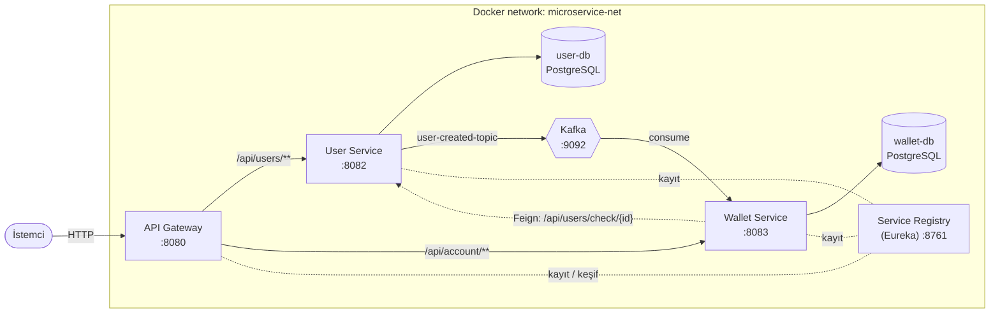
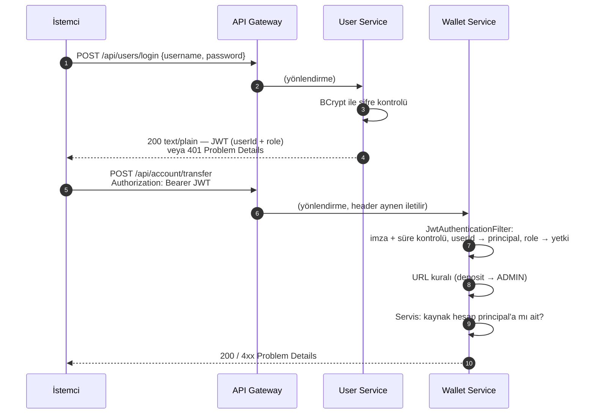
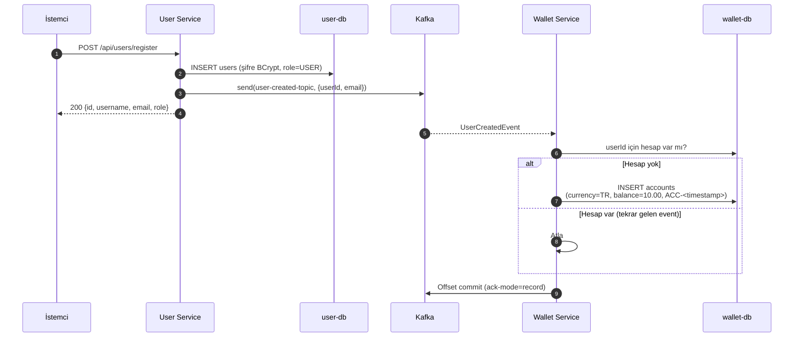
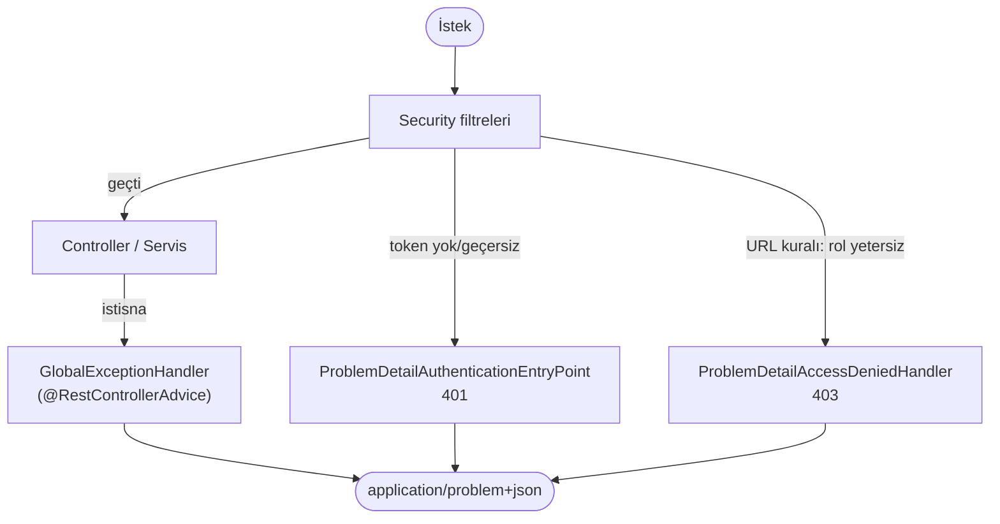

# Microservice Wallet — Teknik Doküman

Bu doküman, Microservice Wallet uygulamasının mimarisini, servislerin birbirleriyle nasıl çalıştığını, güvenlik modelini, hata yönetimini, veri modelini ve tüm REST endpoint'lerini anlatır. Endpoint davranışları ve hata kodları, çalışan sistem üzerinde test edilerek doğrulanmıştır.

**Son güncelleme:** 2026-11-03. Güvenlik düzeltmeleri (yetkilendirme, rol sistemi, validation, kilitleme), global hata yönetimi ve Kafka consumer hata yönetimi (retry, DLT, idempotency) bu sürüme işlenmiştir. Kafka'ya yeni başlayanlar için: [Kafka Kılavuzu](kafka-kilavuzu.md). Yapılan değişikliklerin listesi için: [Değişiklik Kaydı](degisiklikler.md). Açık sorunlar için: [Yapılacaklar](yapilacaklar.md).

## İçindekiler

1. [Genel Bakış](#1-genel-bakış)
2. [Teknoloji Yığını](#2-teknoloji-yığını)
3. [Mimari](#3-mimari)
4. [Modüller ve Servisler](#4-modüller-ve-servisler)
5. [Kimlik Doğrulama ve Yetkilendirme](#5-kimlik-doğrulama-ve-yetkilendirme)
6. [Event-Driven Akış (Kafka)](#6-event-driven-akış-kafka)
7. [Veri Modeli](#7-veri-modeli)
8. [API Referansı](#8-api-referansı)
9. [Hata Yönetimi](#9-hata-yönetimi)
10. [Kurulum ve Çalıştırma](#10-kurulum-ve-çalıştırma)
11. [Konfigürasyon](#11-konfigürasyon)
12. [Bilinen Sorunlar](#12-bilinen-sorunlar)

---

## 1. Genel Bakış

Microservice Wallet, kullanıcıların kayıt olup giriş yapabildiği, cüzdan hesabı açabildiği ve hesaplar arasında transfer yapabildiği bir dijital cüzdan uygulamasıdır. Hesaplara para yatırma işlemi yalnızca **ADMIN** rolündeki kullanıcılar tarafından yapılır.

Uygulama mikroservis mimarisiyle kurulmuştur:

- Dış dünyadan gelen tüm istekler tek bir **API Gateway** üzerinden girer.
- Servisler birbirlerini **Eureka** üzerinden bulur.
- Her servisin kendi **PostgreSQL** veritabanı vardır (database-per-service).
- Kullanıcı kaydı sonrası cüzdan oluşturma, **Kafka** üzerinden asenkron olarak yapılır.
- Kimlik doğrulama ve rol bilgisi, ortak bir modüldeki **JWT** altyapısıyla taşınır.
- Tüm hata cevapları **RFC 9457 Problem Details** (`application/problem+json`) formatındadır.

## 2. Teknoloji Yığını

| Katman | Teknoloji | Sürüm |
|---|---|---|
| Dil | Java | 21 |
| Framework | Spring Boot | 3.2.4 |
| Mikroservis altyapısı | Spring Cloud (Gateway, Netflix Eureka, OpenFeign) | 2023.0.0 |
| Güvenlik | Spring Security + JJWT | JJWT 0.11.5 |
| Doğrulama | Jakarta Bean Validation (`spring-boot-starter-validation`) | Boot ile gelen |
| Hata formatı | RFC 9457 Problem Details (Spring `ProblemDetail`) | Spring Framework 6.1 |
| Veri erişimi | Spring Data JPA / Hibernate | Boot ile gelen |
| Veritabanı | PostgreSQL | 15 (alpine) |
| Mesajlaşma | Apache Kafka (Confluent `cp-kafka`, KRaft modu) | `latest` |
| Build | Maven (multi-module) | 3.9.x |
| Çalıştırma | Docker / Docker Compose | — |
| Yardımcı | Lombok | — |

## 3. Mimari

### 3.1 Bileşen Diyagramı



### 3.2 Portlar

| Bileşen | Container içi port | Host'a açık mı? |
|---|---|---|
| API Gateway | 8080 | Evet — `localhost:8080` |
| Service Registry (Eureka) | 8761 | Evet — `localhost:8761` |
| User Service | 8082 | Hayır (yalnızca gateway üzerinden) |
| Wallet Service | 8083 | Hayır (yalnızca gateway üzerinden) |
| user-db / wallet-db | 5432 | Hayır |
| Kafka | 9092 (broker), 9093 (controller) | Hayır |

User ve Wallet servislerinin portları host'a açılmadığı için bu servislere dışarıdan yalnızca gateway üzerinden ulaşılabilir.

### 3.3 Servis Keşfi ve Yönlendirme

Gateway, istekleri yol (path) önekine göre yönlendirir. `lb://` öneki, hedef adresin Eureka'dan çözüleceğini ve istemci tarafında yük dengeleme (Spring Cloud LoadBalancer) yapılacağını belirtir:

| Route ID | Path | Hedef |
|---|---|---|
| `user-service` | `/api/users/**` | `lb://user-service` |
| `wallet-service` | `/api/account/**` | `lb://wallet-service` |

Ek olarak `spring.cloud.gateway.discovery.locator.enabled=true` açıktır. Bu ayarla Eureka'daki her servis `/{servis-adı}/**` yolundan da erişilebilir hale gelir (örn. `/user-service/api/users/check/1`).

Bir servis yeniden başlatıldığında gateway'in Eureka önbelleği yenilenene kadar (yaklaşık 30 saniye) o servise giden istekler **503** veya **500** dönebilir. Bu hatalar gateway'den geldiği için Problem Details formatında değildir.

## 4. Modüller ve Servisler

Proje, kök dizindeki `pom.xml`'de tanımlı bir Maven multi-module projesidir:

```
microservice-wallet-spring/
├── pom.xml                 # Parent POM (sürüm yönetimi)
├── docker-compose.yml
├── .env                    # JWT_SECRET (git'e girmez)
├── docs/                   # Teknik doküman, değişiklik kaydı, yapılacaklar
├── common-security/        # Ortak kütüphane: JWT + hata yönetimi (çalıştırılabilir değil)
├── service-registry/       # Eureka Server
├── api-gateway/            # Spring Cloud Gateway
├── user-service/           # Kullanıcı yönetimi + Kafka producer
└── wallet-service/         # Hesap yönetimi + Kafka consumer + Feign client
```

### 4.1 common-security

User Service ve Wallet Service'in ortak kullandığı kütüphane modülüdür (`com.wallet:common-security`). İki servis de `com.wallet.common` paketini tarar (`@ComponentScan`). Bu modülde yapılan her değişiklikten sonra **iki servis de** yeniden derlenmelidir.

Modül adı tarihsel olarak `common-security`'dir; artık hata yönetimini de içerir.

**`com.wallet.common.security` — kimlik doğrulama:**

| Sınıf | Görev |
|---|---|
| `JwtService` | Token üretir (`generateToken(username, userId, role)`), doğrular (`validateToken`) ve claim'leri okur (`extractUsername`, `extractUserId`, `extractRole`). |
| `JwtConfig` | `jwt.secret` değerini okuyup `JwtService` bean'ini oluşturur. |
| `JwtAuthenticationFilter` | Her istekte `Authorization: Bearer <token>` header'ını okur. Token geçerliyse `userId`'yi principal, `ROLE_<rol>`'ü yetki olarak `SecurityContext`'e koyar. |
| `CurrentUser` | `CurrentUser.id()` ile isteği yapan kullanıcının id'sini döner. Controller'larda tekrar eden principal okuma kodunun yerini alır. |
| `ProblemDetailAuthenticationEntryPoint` | Token yok/geçersiz → **401** Problem Details. |
| `ProblemDetailAccessDeniedHandler` | URL kuralı yetki hatası (örn. USER'ın para yatırması) → **403** Problem Details. |

**`com.wallet.common.exception` — hata yönetimi** (ayrıntı: [Bölüm 9](#9-hata-yönetimi)):

| Sınıf | Görev |
|---|---|
| `ApiException` | Uygulama hatalarının temel sınıfı; HTTP durumu ve `errorCode` taşır. |
| `InvalidRequestException` | 400 |
| `InvalidCredentialsException` | 401 |
| `ResourceNotFoundException` | 404 |
| `ConflictException` | 409 |
| `BusinessRuleException` | 422 |
| `GlobalExceptionHandler` | `@RestControllerAdvice`; tüm hataları Problem Details'e çevirir. |
| `ProblemDetails` | Ortak cevap üretimi (`errorCode`, `timestamp` alanları). |

### 4.2 service-registry

Eureka Server'dır (`:8761`). Kendisini kayıt etmez (`register-with-eureka=false`). Dashboard'u `http://localhost:8761` adresindedir.

### 4.3 api-gateway

Spring Cloud Gateway (reaktif / WebFlux) tabanlıdır. Güvenlik konfigürasyonu tüm isteklere izin verir (`anyExchange().permitAll()`) ve CSRF kapalıdır. **Gateway JWT doğrulaması yapmaz**; token doğrulama ve yetkilendirme arkadaki servislerde yapılır. Gateway'de `org.springframework.cloud.gateway` ve `org.springframework.web` için DEBUG loglama açıktır.

### 4.4 user-service

Kullanıcı kaydı, girişi ve sorgulamasından sorumludur.

- **Veritabanı:** `user_db` → `users` tablosu
- **Şifreleme:** `BCryptPasswordEncoder`
- **Rol:** Yeni kayıtlara sunucu tarafında `USER` rolü atanır. Rol istemciden alınmaz.
- **Doğrulama:** Kayıt (`UserRequest`) ve giriş (`AuthRequest`) istekleri Bean Validation ile doğrulanır.
- **Kafka:** Kayıt sonrası `user-created-topic`'e `UserCreatedEvent` gönderir. Kafka'ya gönderim hata verirse kullanıcı yine de kaydedilir, hata loglanır.
- **Herkese açık endpoint'ler:** `/api/users/register`, `/api/users/login`. Diğerleri JWT ister.

### 4.5 wallet-service

Hesap (cüzdan) yönetimi, para yatırma ve transferden sorumludur.

- **Veritabanı:** `wallet_db` → `accounts` tablosu
- **Kafka:** `user-created-topic`'i `wallet-group` consumer group'u ile dinler ve yeni her kullanıcıya otomatik hesap açar. Hatalı mesajlar tekrar denenir, sonra `user-created-topic.DLT`'ye yazılır; tekrar gelen event ikinci hesap açmaz (bkz. [6.3](#63-hata-durumu)).
- **Feign:** Manuel hesap açılışında kullanıcının varlığını `user-service`'e sorar (`GET /api/users/check/{id}`). `FeignConfig` sayesinde gelen isteğin `Authorization` header'ı bu çağrıya aynen eklenir (token propagation).
- **Güvenlik:** Tüm endpoint'ler JWT ister. `POST /api/account/deposit` ayrıca ADMIN rolü ister.
- **Doğrulama:** Transfer isteği (`TransferRequest`) Bean Validation anotasyonlarıyla doğrulanır.
- **Eşzamanlılık:** Bakiye değiştiren işlemler hesap satırlarını pessimistic lock ile kilitler (bkz. [8.8](#88-transfer)).

## 5. Kimlik Doğrulama ve Yetkilendirme

### 5.1 JWT Yapısı

| Alan | Değer |
|---|---|
| Algoritma | HS256 |
| İmza anahtarı | `JWT_SECRET` ortam değişkeni (**Base64 kodlu** olmalıdır, çözülmüş hali en az 256 bit) |
| `sub` | Kullanıcı adı |
| `userId` | Kullanıcının ID'si (Long) |
| `role` | Kullanıcının rolü: `USER` veya `ADMIN` |
| `iat` | Oluşturulma zamanı |
| `exp` | Oluşturulmadan **30 dakika** sonra |

Örnek payload:

```json
{"role":"ADMIN","userId":13,"sub":"admin","iat":1793628230,"exp":1793630030}
```

### 5.2 Kimlik Doğrulama Akışı



### 5.3 Filtre ve Hata Davranışı

| Durum | Kod | `errorCode` |
|---|---|---|
| `Authorization` header'ı yok veya `Bearer ` ile başlamıyor | **401** | `UNAUTHORIZED` |
| Token geçersiz veya süresi dolmuş | **401** | `UNAUTHORIZED` |
| Token geçerli ama rol yetersiz (URL kuralı) | **403** | `ACCESS_DENIED` |
| Token geçerli ama kaynak başkasına ait (sahiplik kontrolü) | **403** | `ACCESS_DENIED` |

- Principal, kullanıcı adı değil **`userId` (Long)** değeridir. Sahiplik kontrolleri bu değerle yapılır (`CurrentUser.id()`).
- Token'da `role` claim'i yoksa (rol sisteminden önce üretilmiş token'lar) kullanıcı rolsüz sayılır: normal işlemleri yapabilir, ADMIN işlemlerini yapamaz.

### 5.4 Roller

| Rol | Nasıl atanır | Yetkiler |
|---|---|---|
| `USER` | Kayıtta otomatik | Kendi bilgilerini görme, kendine hesap açma, kendi hesaplarını listeleme, kendi hesabından transfer |
| `ADMIN` | Yalnızca veritabanından (bkz. [10.4](#104-admin-kullanıcı-oluşturma)) | `USER` yetkileri + **herhangi bir hesaba** para yatırma |

Rol yetkilendirmesi şu zincirle çalışır:

1. user-service, girişte kullanıcının rolünü token'a `role` claim'i olarak yazar.
2. `JwtAuthenticationFilter`, bu claim'den `ROLE_<rol>` yetkisini (authority) üretip `SecurityContext`'e koyar.
3. wallet-service'teki `SecurityConfig`, `POST /api/account/deposit` için `hasRole("ADMIN")` kuralı uygular. Spring bu kuralda `ROLE_ADMIN` yetkisini arar.

**Rol değişikliklerinin etkisi:** Rol, giriş sırasında token'a yazıldığı için veritabanındaki bir rol değişikliği ancak kullanıcının bir sonraki girişinde etkili olur. Admin yetkisi kaldırılan bir kullanıcı, eski token'ının süresi dolana kadar (en fazla 30 dakika) admin olarak kalır.

### 5.5 Sahiplik (Ownership) Kontrolleri

| Endpoint | Kontrol | Yer |
|---|---|---|
| `GET /api/users/{id}` | `id` == token'daki `userId` | `UserController` (DB sorgusundan önce) |
| `GET /api/account/user/{userId}` | `userId` == token'daki `userId` | `AccountController` |
| `POST /api/account/accounts` | Hesap her zaman token sahibine açılır; istemci `userId` gönderemez | `AccountController` |
| `POST /api/account/transfer` | Kaynak hesabın sahibi == token'daki `userId` | `AccountService` |
| `POST /api/account/deposit` | Sahiplik kontrolü yok; ADMIN rolü gerekir | `SecurityConfig` |

İhlallerde servis `AccessDeniedException` fırlatır; `GlobalExceptionHandler` bunu 403 Problem Details'e çevirir.

`GET /api/users/{id}`'de kontrolün veritabanı sorgusundan önce yapılması, başkasına ait var olan ve olmayan id'ler için aynı 403 cevabını verir. Böylece kullanıcı id'leri tahmin edilemez (enumeration). Aynı nedenle giriş, kullanıcı adı yanlış da olsa şifre yanlış da olsa aynı 401 mesajını döner.

### 5.6 Şifre Güvenliği

- Şifreler veritabanında BCrypt hash'i olarak tutulur.
- `User.password` alanı `@JsonProperty(access = WRITE_ONLY)` ile işaretlidir, bu yüzden hiçbir API cevabında şifre veya hash dönmez.

## 6. Event-Driven Akış (Kafka)

### 6.1 Kayıt → Otomatik Cüzdan



Kayıt cevabı, cüzdan oluşturulmadan **önce** döner. Bu yüzden kayıttan hemen sonra hesap listesi boş görünebilir; birkaç saniye içinde hesap oluşur.

Kafka kavramlarının ve buradaki her ayarın ayrıntılı açıklaması için: [Kafka Kılavuzu](kafka-kilavuzu.md).

### 6.2 Topic ve Mesaj

| Özellik | Değer |
|---|---|
| Topic | `user-created-topic` (1 partition; ilk mesajda otomatik oluşur) |
| Dead letter topic | `user-created-topic.DLT` (1 partition; wallet-service açılışta oluşturur) |
| Producer | user-service — `UserProducer` |
| Consumer | wallet-service — `UserConsumer`, group `wallet-group` |
| Key | Yok (null) |
| Value formatı | JSON. Producer: `JsonSerializer`. Consumer: `ErrorHandlingDeserializer` → `JsonDeserializer` |
| Varsayılan tip | `__TypeId__` header'ı yoksa `UserCreatedEvent` (`spring.json.value.default.type`) |
| Payload | `{"userId": <Long>, "email": "<String>"}` |
| Ack modu | `record`: her mesaj başarıyla işlenince (veya DLT'ye yazılınca) offset commit edilir |
| Offset reset | `earliest` |

`JsonSerializer`, mesaja `__TypeId__` header'ı olarak `com.wallet.user_service.dto.UserCreatedEvent` sınıf adını ekler. Consumer bu sınıfı aynı paket adıyla bulabilsin diye wallet-service'te de `com/wallet/user_service/dto/UserCreatedEvent.java` vardır. **İki taraftaki record'un paket adı ve alanları aynı tutulmalıdır.**

### 6.3 Hata Durumu

Hata yönetimi [`KafkaErrorHandlingConfig`](../wallet-service/src/main/java/com/wallet/wallet_service/config/KafkaErrorHandlingConfig.java)'teki `DefaultErrorHandler` ile yapılır. Kafka consumer HTTP katmanında olmadığı için `GlobalExceptionHandler` buraya uygulanmaz.

| Durum | Davranış |
|---|---|
| Geçici hata (örn. veritabanı erişilemiyor) | 3 kez tekrar denenir (1 sn, 2 sn, 4 sn bekleyerek; bloklayıcı). Hepsi başarısız olursa mesaj DLT'ye yazılır |
| Bozuk JSON (deserialization hatası) | Denenmeden DLT'ye yazılır; consumer takılmaz |
| `userId` eksik (`InvalidRequestException`) | Denenmeden DLT'ye yazılır |
| Aynı `userId` için tekrar gelen event | `existsByUserId` kontrolüyle atlanır; ikinci hesap açılmaz (idempotency) |

DLT'deki mesajlar orijinal içeriği ve hatayı açıklayan `kafka_dlt-*` header'larını taşır. Otomatik yeniden işleme veya alarm yoktur (#33). İnceleme ve yeniden gönderme komutları: [Kafka Kılavuzu — Bölüm 9](kafka-kilavuzu.md#9-dlt-dead-letter-topic).

**Idempotency kontrolünün sınırı:** Kullanıcının herhangi bir hesabı varsa event atlanır. Event gecikir ve kullanıcı bu arada elle hesap açarsa otomatik hesap açılmaz.

## 7. Veri Modeli

Tablolar Hibernate tarafından otomatik oluşturulur (`ddl-auto=update`).

### 7.1 `user_db.users`

| Kolon | Tip | Kısıt | Açıklama |
|---|---|---|---|
| `id` | bigserial | PK | |
| `username` | varchar(255) | NOT NULL, UNIQUE | |
| `password` | varchar(255) | NOT NULL | BCrypt hash; API cevaplarında dönmez |
| `email` | varchar(255) | | Benzersiz değil; gönderilirse e-posta formatında olmalı |
| `role` | varchar(255) | | `USER` (kayıtta varsayılan) veya `ADMIN`. Veritabanı seviyesinde kısıt yok. |

Rol sisteminden önce oluşturulmuş kayıtlarda `role` `null` olabilir. Bu kayıtlar [10.4](#104-admin-kullanıcı-oluşturma)'teki SQL ile `USER` yapılmalıdır.

### 7.2 `wallet_db.accounts`

| Kolon | Tip | Kısıt | Açıklama |
|---|---|---|---|
| `id` | bigserial | PK | |
| `account_number` | varchar(255) | — | `ACC-<epoch millis>` biçiminde. Entity'de `@Column(unique = true, nullable = false)` var, ancak mevcut veritabanında kısıt oluşmadı (bkz. #9). |
| `currency` | varchar(255) | — | Serbest metin (otomatik hesaplarda `TR`) |
| `balance` | numeric(38,2) | — | Açılış bakiyesi `10.00` |
| `user_id` | bigint | — | `users.id`'ye mantıksal referans. Servisler ayrı veritabanında olduğu için foreign key yok. |

Bir kullanıcının birden fazla hesabı olabilir.

## 8. API Referansı

**Base URL:** `http://localhost:8080`

**Erişim:** 🔓 herkese açık · 🔒 `Authorization: Bearer <JWT>` gerekir · 👑 ADMIN rolü gerekir

**Hata cevapları:** Tüm hatalar `application/problem+json` formatında döner (bkz. [Bölüm 9](#9-hata-yönetimi)). Aşağıdaki tablolarda her hata için `errorCode` belirtilmiştir. Token isteyen tüm endpoint'ler, token yok veya geçersizse **401 `UNAUTHORIZED`** döner; bu satır tablolarda tekrarlanmamıştır.

### Özet

| # | Metot | Yol | Erişim | Servis |
|---|---|---|---|---|
| 1 | POST | `/api/users/register` | 🔓 | user-service |
| 2 | POST | `/api/users/login` | 🔓 | user-service |
| 3 | GET | `/api/users/{id}` | 🔒 yalnızca kendisi | user-service |
| 4 | GET | `/api/users/check/{id}` | 🔒 | user-service |
| 5 | GET | `/api/account/user/{userId}` | 🔒 yalnızca kendisi | wallet-service |
| 6 | POST | `/api/account/accounts` | 🔒 kendine | wallet-service |
| 7 | POST | `/api/account/deposit` | 👑 | wallet-service |
| 8 | POST | `/api/account/transfer` | 🔒 kendi hesabından | wallet-service |

---

### 8.1 Kullanıcı Kaydı

`POST /api/users/register` 🔓

Yeni kullanıcıyı `USER` rolüyle oluşturur ve Kafka üzerinden otomatik cüzdan açılışını tetikler.

**İstek gövdesi** (`application/json`):

| Alan | Tip | Doğrulama | Açıklama |
|---|---|---|---|
| `username` | string | `@NotBlank` | Benzersiz olmalı |
| `password` | string | `@NotBlank` | BCrypt ile hash'lenir |
| `email` | string | `@Email` | Opsiyonel; gönderilirse geçerli e-posta olmalı |

Gövdede `role` alanı gönderilse bile yok sayılır; rol her zaman `USER` atanır.

```json
{ "username": "merve", "email": "merve@example.com", "password": "123" }
```

**Cevaplar:**

| Kod | `errorCode` | Durum |
|---|---|---|
| 200 | — | `{"id":11,"username":"merve","email":"merve@example.com","role":"USER"}` |
| 400 | `VALIDATION_FAILED` | Boş kullanıcı adı/şifre veya geçersiz e-posta; `errors` alanında alan bazında mesajlar |
| 400 | `INVALID_REQUEST` | Bozuk JSON |
| 409 | `USERNAME_ALREADY_EXISTS` | Kullanıcı adı zaten kullanılıyor |
| 409 | `DATA_CONFLICT` | Aynı adla eşzamanlı kayıt (veritabanı UNIQUE kısıtı) |

```bash
curl -X POST http://localhost:8080/api/users/register \
  -H 'Content-Type: application/json' \
  -d '{"username":"merve","email":"merve@example.com","password":"123"}'
```

---

### 8.2 Giriş

`POST /api/users/login` 🔓

**İstek gövdesi** (`application/json`):

| Alan | Tip | Doğrulama |
|---|---|---|
| `username` | string | `@NotBlank` |
| `password` | string | `@NotBlank` |

**Cevaplar:**

| Kod | `errorCode` | Durum |
|---|---|---|
| 200 | — | JWT, **düz metin** (`text/plain`), JSON değil. `userId` ve `role` claim'lerini içerir. |
| 400 | `VALIDATION_FAILED` | Boş kullanıcı adı veya şifre |
| 401 | `INVALID_CREDENTIALS` | Yanlış şifre **veya** olmayan kullanıcı (aynı mesaj: "Kullanıcı adı veya şifre hatalı") |

```bash
TOKEN=$(curl -s -X POST http://localhost:8080/api/users/login \
  -H 'Content-Type: application/json' \
  -d '{"username":"merve","password":"123"}')
```

---

### 8.3 Kullanıcı Getir

`GET /api/users/{id}` 🔒 yalnızca kendisi

| Parametre | Yer | Tip | Açıklama |
|---|---|---|---|
| `id` | path | Long | Token'daki `userId` ile **aynı olmalı** |

**Cevaplar:**

| Kod | `errorCode` | Durum |
|---|---|---|
| 200 | — | `{"id":11,"username":"merve","email":"...","role":"USER"}` |
| 403 | `ACCESS_DENIED` | Başka bir kullanıcının id'si (var olsun ya da olmasın) |
| 404 | `RESOURCE_NOT_FOUND` | Token sahibi veritabanında yok (silinmiş kullanıcı) |

---

### 8.4 Kullanıcı Var mı?

`GET /api/users/check/{id}` 🔒

Servisler arası kullanım içindir; wallet-service'teki Feign client hesap açarken çağırır. Sahiplik kontrolü yoktur, ama yalnızca `true`/`false` döner ve kişisel veri içermez.

| Kod | Durum |
|---|---|
| 200 | `true` veya `false` |

---

### 8.5 Kullanıcının Hesaplarını Listele

`GET /api/account/user/{userId}` 🔒 yalnızca kendisi

| Parametre | Yer | Tip | Açıklama |
|---|---|---|---|
| `userId` | path | Long | Token'daki `userId` ile **aynı olmalı** |

**Cevaplar:**

| Kod | `errorCode` | Durum |
|---|---|---|
| 200 | — | Hesap dizisi (hesap yoksa `[]`) |
| 403 | `ACCESS_DENIED` | Başka kullanıcının id'si |

```json
[
  {"id":3,"accountNumber":"ACC-1793616122131","currency":"TR","balance":10.00,"userId":3}
]
```

```bash
curl http://localhost:8080/api/account/user/3 -H "Authorization: Bearer $TOKEN"
```

---

### 8.6 Hesap Aç

`POST /api/account/accounts` 🔒 kendine

Token sahibine yeni bir hesap açar. Parametreler **query string** ile gönderilir, body yoktur.

| Parametre | Yer | Tip | Açıklama |
|---|---|---|---|
| `currency` | query | string | Serbest metin (örn. `TRY`, `USD`) |

Hesabın sahibi token'daki `userId`'den alınır. İstekte `userId` parametresi gönderilirse yok sayılır. Yeni hesap `10.00` bakiyeyle açılır. Kullanıcının varlığı user-service'e Feign ile sorulur.

**Cevaplar:**

| Kod | `errorCode` | Durum |
|---|---|---|
| 200 | — | `Hesap başarılı bir şekilde oluşturuldu. Hesap no: ACC-...` (`text/plain`) |
| 400 | `INVALID_REQUEST` | `currency` parametresi yok |
| 404 | `RESOURCE_NOT_FOUND` | Token sahibi user-service'te yok |
| 500 | `INTERNAL_ERROR` | user-service'e ulaşılamadı (Feign hatası) |

```bash
curl -X POST "http://localhost:8080/api/account/accounts?currency=USD" \
  -H "Authorization: Bearer $TOKEN"
```

---

### 8.7 Para Yatır

`POST /api/account/deposit` 👑 ADMIN

Herhangi bir hesaba para yatırır. Dışarıdan gelen parayı sisteme sokan yetkili işlem olarak tasarlanmıştır; bu yüzden sahiplik kontrolü yoktur, bunun yerine ADMIN rolü gerekir.

| Parametre | Yer | Tip | Açıklama |
|---|---|---|---|
| `accountNumber` | query | string | Hedef hesap |
| `amount` | query | decimal | 0'dan büyük olmalı |

İşlem sırasında hesap satırı kilitlenir (`SELECT ... FOR UPDATE`).

**Cevaplar:**

| Kod | `errorCode` | Durum |
|---|---|---|
| 200 | — | `Para yatırıldı. Guncel bakiyeniz:60.00` (`text/plain`) |
| 400 | `INVALID_REQUEST` | `amount <= 0`, sayı olmayan `amount` veya eksik parametre |
| 403 | `ACCESS_DENIED` | ADMIN değil |
| 404 | `RESOURCE_NOT_FOUND` | Hesap bulunamadı |

```bash
curl -X POST "http://localhost:8080/api/account/deposit?accountNumber=ACC-1793616122131&amount=50" \
  -H "Authorization: Bearer $ADMIN_TOKEN"
```

---

### 8.8 Transfer

`POST /api/account/transfer` 🔒 kendi hesabından

**İstek gövdesi** (`application/json`):

| Alan | Tip | Doğrulama | Açıklama |
|---|---|---|---|
| `fromAccount` | string | `@NotBlank` | Kaynak hesap numarası; token sahibine ait olmalı |
| `toAccount` | string | `@NotBlank` | Hedef hesap numarası; herhangi bir kullanıcıya ait olabilir |
| `amount` | decimal | `@NotNull`, `@Positive` | Tutar |
| — | — | `@AssertTrue isDifferentAccounts()` | Kaynak ve hedef hesap aynı olamaz. Hata `errors` listesinde `differentAccounts` alanıyla döner |

```json
{ "fromAccount": "ACC-1793618007270", "toAccount": "ACC-1793618007340", "amount": 20 }
```

**İşleyiş:**

1. Gövde Bean Validation ile doğrulanır (`@Valid`). Geçersiz istek servis katmanına ulaşmaz.
2. Servis katmanında tutar (`amount > 0`) ve hesapların farklılığı tekrar kontrol edilir. Bu, `transferMoney`'nin HTTP dışından çağrılması durumuna karşı ikinci bir güvencedir; ihlal `INVALID_REQUEST` döner.
3. İki hesap, **hesap numarasına göre sıralı** olarak kilitlenir (`SELECT ... FOR UPDATE`). Sıralı kilitleme, karşılıklı eşzamanlı transferlerde (A→B ve B→A) deadlock'u önler.
4. Kaynak hesabın token sahibine ait olduğu kontrol edilir.
5. Bakiye yeterliliği kontrol edilir, bakiyeler güncellenir. Tüm işlem tek bir transaction'dır.

**Cevaplar:**

| Kod | `errorCode` | Durum |
|---|---|---|
| 200 | — | `Transfer başarıyla gerçekleşti.` (`text/plain`) |
| 400 | `VALIDATION_FAILED` | Boş hesap numarası, eksik/negatif/sıfır tutar, kaynak ve hedef hesap aynı; `errors` alanında alan bazında mesajlar |
| 400 | `INVALID_REQUEST` | Bozuk JSON |
| 403 | `ACCESS_DENIED` | Kaynak hesap başkasına ait |
| 404 | `RESOURCE_NOT_FOUND` | Kaynak veya hedef hesap bulunamadı |
| 422 | `INSUFFICIENT_BALANCE` | Yetersiz bakiye |

```bash
curl -X POST http://localhost:8080/api/account/transfer \
  -H 'Content-Type: application/json' -H "Authorization: Bearer $TOKEN" \
  -d '{"fromAccount":"ACC-1793618007270","toAccount":"ACC-1793618007340","amount":20}'
```

**Eşzamanlılık testi sonucu:** 11.00 bakiyeli bir hesaptan aynı anda 20 adet 1.00'lik transfer gönderildiğinde tam olarak 11 işlem başarılı oldu, 9'u yetersiz bakiye ile reddedildi, kaynak bakiye `0.00`'a indi ve toplam bakiye korundu. Loglarda deadlock görülmedi.

## 9. Hata Yönetimi

### 9.1 Cevap Formatı

Tüm hata cevapları **RFC 9457 Problem Details** standardındadır. `Content-Type: application/problem+json`.

```json
{
  "type": "about:blank",
  "title": "Unprocessable Entity",
  "status": 422,
  "detail": "Yetersiz bakiye",
  "instance": "/api/account/transfer",
  "errorCode": "INSUFFICIENT_BALANCE",
  "timestamp": "2026-11-03T07:34:19.492940346Z"
}
```

| Alan | Kaynak | Açıklama |
|---|---|---|
| `type` | RFC 9457 | Her zaman `about:blank`; hata türü `errorCode` ile belirtilir |
| `title` | RFC 9457 | HTTP durumunun standart adı |
| `status` | RFC 9457 | HTTP durum kodu |
| `detail` | RFC 9457 | İnsan tarafından okunabilir açıklama (uygulama hatalarında Türkçe) |
| `instance` | RFC 9457 | İsteğin yolu |
| `errorCode` | Uzantı | **Makine tarafından okunabilir hata kodu.** İstemciler hata türünü `detail` metnine göre değil bu alana göre ayırt etmelidir. |
| `timestamp` | Uzantı | Hatanın oluştuğu an (UTC, ISO-8601) |
| `errors` | Uzantı | Yalnızca `VALIDATION_FAILED`'da: `[{"field": "...", "message": "..."}]` |

Validation hatası örneği:

```json
{
  "type": "about:blank",
  "title": "Bad Request",
  "status": 400,
  "detail": "İstek doğrulanamadı",
  "instance": "/api/account/transfer",
  "errorCode": "VALIDATION_FAILED",
  "timestamp": "2026-11-03T07:34:19.439127304Z",
  "errors": [
    {"field": "amount", "message": "Transfer tutarı 0'dan büyük olmalıdır"},
    {"field": "fromAccount", "message": "Kaynak hesap numarası boş olamaz"}
  ]
}
```

### 9.2 Hata Kodları

| HTTP | `errorCode` | Kaynak | Ne zaman |
|---|---|---|---|
| 400 | `VALIDATION_FAILED` | `@Valid` | İstek gövdesi doğrulanamadı |
| 400 | `INVALID_REQUEST` | `InvalidRequestException` / Spring | Geçersiz girdi, bozuk JSON, eksik parametre, tip uyuşmazlığı |
| 401 | `UNAUTHORIZED` | Security entry point | Token yok, geçersiz veya süresi dolmuş |
| 401 | `INVALID_CREDENTIALS` | `InvalidCredentialsException` | Giriş bilgileri hatalı |
| 403 | `ACCESS_DENIED` | Security / `AccessDeniedException` | Rol yetersiz veya kaynak başkasına ait |
| 404 | `RESOURCE_NOT_FOUND` | `ResourceNotFoundException` | Kullanıcı veya hesap bulunamadı |
| 404 | `NOT_FOUND` | Spring | Tanımsız yol |
| 405 | `METHOD_NOT_ALLOWED` | Spring | Yanlış HTTP metodu |
| 409 | `USERNAME_ALREADY_EXISTS` | `ConflictException` | Kullanıcı adı alınmış |
| 409 | `DATA_CONFLICT` | `DataIntegrityViolationException` | Veritabanı kısıt ihlali |
| 415 | `UNSUPPORTED_MEDIA_TYPE` | Spring | Yanlış `Content-Type` |
| 422 | `INSUFFICIENT_BALANCE` | `BusinessRuleException` | Yetersiz bakiye |
| 500 | `INTERNAL_ERROR` | Catch-all | Beklenmeyen hata; ayrıntı yalnızca logda |

### 9.3 Mimari



İki katman vardır, çünkü Spring Security filtreleri controller'dan **önce** çalışır ve orada oluşan hatalar `@RestControllerAdvice`'a hiç ulaşmaz:

| Katman | Sınıf | Karşıladığı hatalar |
|---|---|---|
| Security filtreleri | `ProblemDetailAuthenticationEntryPoint` | Kimlik doğrulanamadı → 401 |
| Security filtreleri | `ProblemDetailAccessDeniedHandler` | `SecurityConfig`'teki URL kuralları → 403 |
| MVC | `GlobalExceptionHandler` | Controller ve servislerden çıkan tüm istisnalar |

`GlobalExceptionHandler`, Spring'in `ResponseEntityExceptionHandler` sınıfından türer. Bu sayede Spring MVC'nin standart hataları (eksik parametre, bozuk JSON, tip uyuşmazlığı, 404, 405, 415) da otomatik olarak aynı formatta döner ve `errorCode`/`timestamp` ile zenginleştirilir.

`/error` yolu iki serviste de `permitAll`'dır. Böylece MVC dışında oluşan nadir hatalar 401/403 arkasına gizlenmez.

### 9.4 Loglama

| Hata türü | Log seviyesi | Not |
|---|---|---|
| `ApiException`, `AccessDeniedException` (4xx) | DEBUG | Beklenen durumlar; üretimde log kirliliği yaratmaz |
| `DataIntegrityViolationException` | WARN | Veritabanı mesajı loglanır, istemciye verilmez |
| Beklenmeyen hatalar (500) | ERROR + stack trace | İstemciye yalnızca "Beklenmeyen bir hata oluştu" döner |

### 9.5 Yeni Hata Ekleme

Servis kodunda `RuntimeException` yerine uygun alt sınıfı fırlatın:

```java
throw new ResourceNotFoundException("Hesap bulunamadı");                      // 404
throw new InvalidRequestException("Tutar 0'dan büyük olmalıdır");             // 400
throw new ConflictException("USERNAME_ALREADY_EXISTS", "Bu kullanıcı adı ..."); // 409
throw new BusinessRuleException("INSUFFICIENT_BALANCE", "Yetersiz bakiye");   // 422
throw new AccessDeniedException("Bu hesaba erişim yetkiniz yok");             // 403
```

Kurallar:

- `detail` mesajı istemciye gösterilir; SQL, stack trace, iç id veya başka hassas bilgi içermemelidir.
- `IllegalArgumentException` kullanmayın: kütüphanelerin fırlattığı `IllegalArgumentException`'lar genellikle sunucu hatasıdır ve 400 olarak dönmemelidir.
- `BusinessRuleException` ve `ConflictException` için ihlal edilen kuralı anlatan, BÜYÜK_HARF biçiminde bir `errorCode` verin. Yeni kodu [9.2](#92-hata-kodları)'deki tabloya ekleyin.

## 10. Kurulum ve Çalıştırma

### 10.1 Gereksinimler

| Araç | Ne için | macOS kurulumu |
|---|---|---|
| Docker Desktop | Tüm sistemi çalıştırmak (zorunlu) | `brew install --cask docker-desktop` |
| JDK 21 | Yerel build / IDE (opsiyonel) | `brew install openjdk@21` |
| Maven 3.9+ | Yerel build (opsiyonel) | `brew install maven` |
| IntelliJ IDEA | Geliştirme (opsiyonel) | `brew install --cask intellij-idea` |

Docker build'leri kendi içinde Maven ve JDK 21 imajı (`maven:3.9.6-eclipse-temurin-21`) kullanır. Bu yüzden sistemi yalnızca Docker ile çalıştırmak için yerelde JDK veya Maven gerekmez.

IntelliJ'de projeyi açarken SDK ve language level olarak **21** seçilmelidir.

### 10.2 Ortam Değişkeni

Kök dizine `.env` dosyası oluşturun (git'e eklenmez):

```dotenv
JWT_SECRET=<base64 kodlu, en az 32 byte'lık rastgele anahtar>
```

Anahtar üretmek için:

```bash
openssl rand -base64 32
```

### 10.3 Başlatma

```bash
docker compose up -d --build
```

1. Eureka dashboard'unda (http://localhost:8761) `API-GATEWAY`, `USER-SERVICE` ve `WALLET-SERVICE`'in UP olduğunu kontrol edin. İlk açılış 30–60 saniye sürebilir.
2. İstekleri `http://localhost:8080` üzerinden gönderin.

### 10.4 Admin Kullanıcı Oluşturma

ADMIN rolü API üzerinden atanamaz; bu bilinçli bir tercihtir. Admin oluşturmak için:

```bash
# 1. Kullanıcıyı normal kayıtla oluşturun (şifre hash'lenir, cüzdan açılır)
curl -X POST http://localhost:8080/api/users/register -H 'Content-Type: application/json' \
  -d '{"username":"admin","email":"admin@example.com","password":"<güçlü-şifre>"}'

# 2. Rolünü veritabanından ADMIN yapın
docker exec user-db psql -U postgres -d user_db \
  -c "UPDATE users SET role = 'ADMIN' WHERE username = 'admin';"

# 3. Giriş yapıp ADMIN rolünü içeren yeni token alın
curl -X POST http://localhost:8080/api/users/login -H 'Content-Type: application/json' \
  -d '{"username":"admin","password":"<güçlü-şifre>"}'
```

Kullanıcıyı SQL ile doğrudan `INSERT` etmeyin: şifre hash'lenmez ve Kafka event'i gönderilmediği için cüzdan açılmaz.

Rol sisteminden önce oluşturulmuş kullanıcıların rolü `null` olabilir. Bunları `USER` yapmak için:

```bash
docker exec user-db psql -U postgres -d user_db \
  -c "UPDATE users SET role = 'USER' WHERE role IS NULL;"
```

Kullanıcıları ve rollerini listelemek için:

```bash
docker exec user-db psql -U postgres -d user_db \
  -c "SELECT id, username, email, role FROM users ORDER BY id;"
```

### 10.5 Uçtan Uca Hızlı Test

```bash
B=http://localhost:8080
curl -s -X POST $B/api/users/register -H 'Content-Type: application/json' \
  -d '{"username":"demo","email":"demo@example.com","password":"123"}'
# → {"id":<ID>,...,"role":"USER"}

TOKEN=$(curl -s -X POST $B/api/users/login -H 'Content-Type: application/json' \
  -d '{"username":"demo","password":"123"}')

# Token içeriğini görmek için:
echo "$TOKEN" | cut -d. -f2 | tr '_-' '/+' | base64 -d 2>/dev/null; echo

sleep 3   # Kafka ile cüzdan oluşturulmasını bekle
curl -s $B/api/account/user/<ID> -H "Authorization: Bearer $TOKEN"
```

### 10.6 Faydalı Komutlar

| Komut | Açıklama |
|---|---|
| `docker compose ps` | Container durumları |
| `docker compose logs -f <servis>` | Servis logları |
| `docker compose up -d --build <servis>` | Tek servisi yeniden derleyip başlatma |
| `docker compose up -d --build user-service wallet-service` | `common-security` değiştiğinde iki servisi birlikte derleme |
| `docker compose down` | Sistemi durdurma |
| `docker compose down -v` | Sistemi durdurup veritabanı verilerini silme |
| `mvn clean install -DskipTests` | Yerel build (JDK 21 ile) |

## 11. Konfigürasyon

### 11.1 Ortam Değişkenleri

| Değişken | Kullanan | Kaynak | Açıklama |
|---|---|---|---|
| `JWT_SECRET` | user-service, wallet-service | `.env` | Base64 JWT imza anahtarı |
| `EUREKA_CLIENT_SERVICE_URL_DEFAULTZONE` | gateway, user, wallet | compose | `http://service-registry:8761/eureka` |
| `SPRING_DATASOURCE_URL` | user, wallet | compose | JDBC adresi |
| `SPRING_DATASOURCE_USERNAME` | user, wallet | compose | `postgres` |
| `SPRING_DATASOURCE_PASSWORD` | user, wallet | compose | compose dosyasında sabit |
| `KAFKA_BOOTSTRAP_SERVERS` | wallet | compose | `kafka:9092` |

user-service, Kafka adresini properties dosyasında sabit olarak `kafka:9092` şeklinde tanımlar.

### 11.2 Önemli Uygulama Ayarları

| Ayar | Değer | Servis |
|---|---|---|
| `spring.jpa.hibernate.ddl-auto` | `update` | user, wallet |
| `spring.jpa.show-sql` | `true` | user, wallet |
| `spring.cloud.openfeign...connect-timeout` / `read-timeout` | 5000 ms | wallet |
| `spring.kafka.listener.ack-mode` | `manual_immediate` | wallet |
| `spring.kafka.consumer.properties.spring.json.trusted.packages` | `*` | wallet |
| `logging.level.org.springframework.security` | `DEBUG` | user |

## 12. Bilinen Sorunlar

Bu bölüm, kodun 2026-11-03 tarihli haline ve çalışan sistem üzerinde yapılan testlere dayanır. Takip listesi için: [Yapılacaklar](yapilacaklar.md).

Kritik ve yüksek öncelikte açık sorun kalmamıştır.

### 12.1 Açık — Orta

| # | Sorun | Çözüm |
|---|---|---|
| 9 | Hesap numarası `ACC-<epoch millis>`; aynı milisaniyede çakışabilir. Entity'ye `@Column(unique = true)` eklendi, ancak Hibernate 6 `ddl-auto=update` tek kolonluk `unique`'i mevcut tabloya eklemiyor; veritabanında kısıt yok. | Numara üretimini UUID / sequence yapmak; kısıtı `@Table(uniqueConstraints = ...)` ile ya da SQL ile eklemek. |
| 12 | Kafka gönderimi DB transaction'ı ile atomik değil. Mesaj gönderilemezse kullanıcı cüzdansız kalır. | Transactional outbox pattern. |
| 14 | Postgres şifreleri compose dosyasında açık metin. | `.env`'e taşımak. |
| 15 | `depends_on` healthcheck kullanmıyor; servisler DB/Kafka hazır olmadan açılabilir. | `healthcheck` + `condition: service_healthy`. |
| 16 | `spring.json.trusted.packages=*` | Yalnızca event paketine izin vermek. |
| 30 | user-service'e ulaşılamadığında hesap açma 500 `INTERNAL_ERROR` dönüyor; gateway hataları (503) Problem Details formatında değil. | wallet-service'te `FeignException` → 503 `SERVICE_UNAVAILABLE`; gateway'e WebFlux hata yöneticisi. |

### 12.2 Açık — Düşük

| # | Sorun | Çözüm |
|---|---|---|
| 17 | `zookeeper` servisi tanımlı ama kullanılmıyor (Kafka KRaft modunda). | Compose'tan kaldırmak. |
| 18 | `cp-kafka` / `cp-zookeeper` imajları `latest`. | Belirli bir sürüm etiketi kullanmak. |
| 19 | `currency` serbest metin; otomatik hesaplarda `TR` (ISO 4217 kodu `TRY`). | Enum veya ISO 4217 doğrulaması. |
| 20 | Başarılı cevaplar tutarsız: giriş, hesap açma, para yatırma ve transfer düz metin dönüyor. | JSON DTO'lar (örn. `{"token": "..."}`, `{"accountNumber": "...", "balance": ...}`). |
| 22 | `show-sql=true`, Security ve Gateway için DEBUG log açık. | Profil bazlı (dev/prod) log ayarı. |
| 23 | Gateway'de merkezi JWT doğrulaması, rate limiting ve CORS politikası yok. | Merkezi doğrulama ve rate limit filtresi. |
| 24 | Test yok. | Birim testleri ve Testcontainers ile entegrasyon testleri. |
| 29 | Spring'in ürettiği bazı hata mesajları İngilizce (örn. "Failed to read request", "Required parameter 'amount' is not present."). | `MessageSource` ile `problemDetail.*` mesajlarını Türkçeleştirmek. |
| 31 | Transfer'de olmayan kaynak hesap 404, başkasına ait kaynak hesap 403 dönüyor; hesap numaralarının varlığı tahmin edilebilir. | Kaynak hesap için iki durumda da 403 dönmek. |
| 33 | DLT'deki mesajlar için alarm ve yeniden işleme mekanizması yok. | DLT lag izleme; DLT'den ana topic'e yeniden gönderme aracı. |

### 12.3 Çözülenler

[Değişiklik Kaydı](degisiklikler.md)'nda ayrıntılı olarak listelenmiştir: #1–#8, #10, #11, #13, #21, #25–#28.
